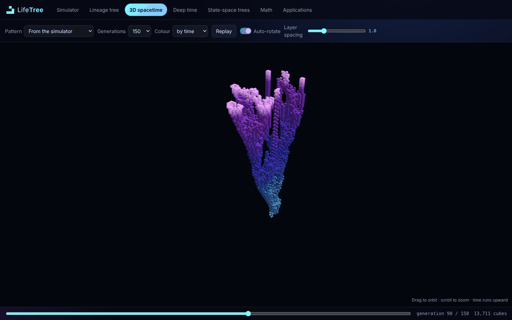
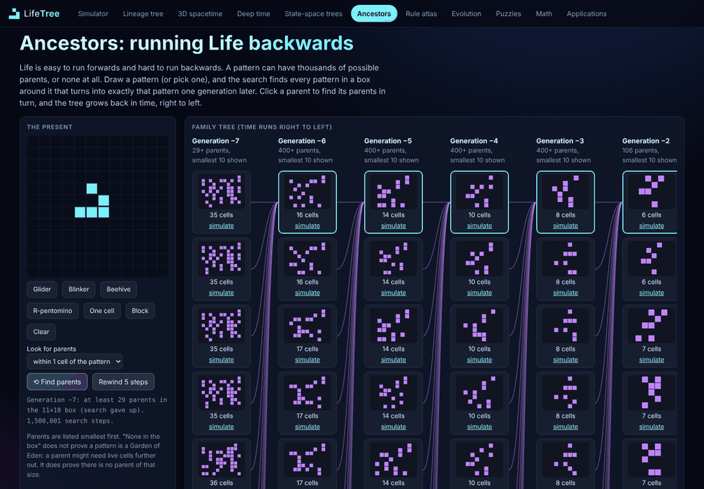
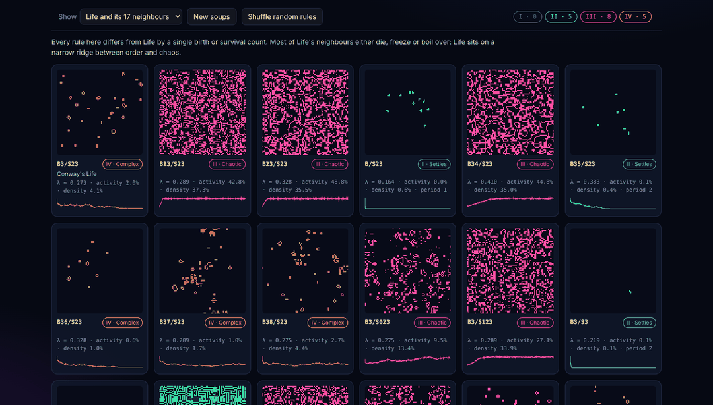
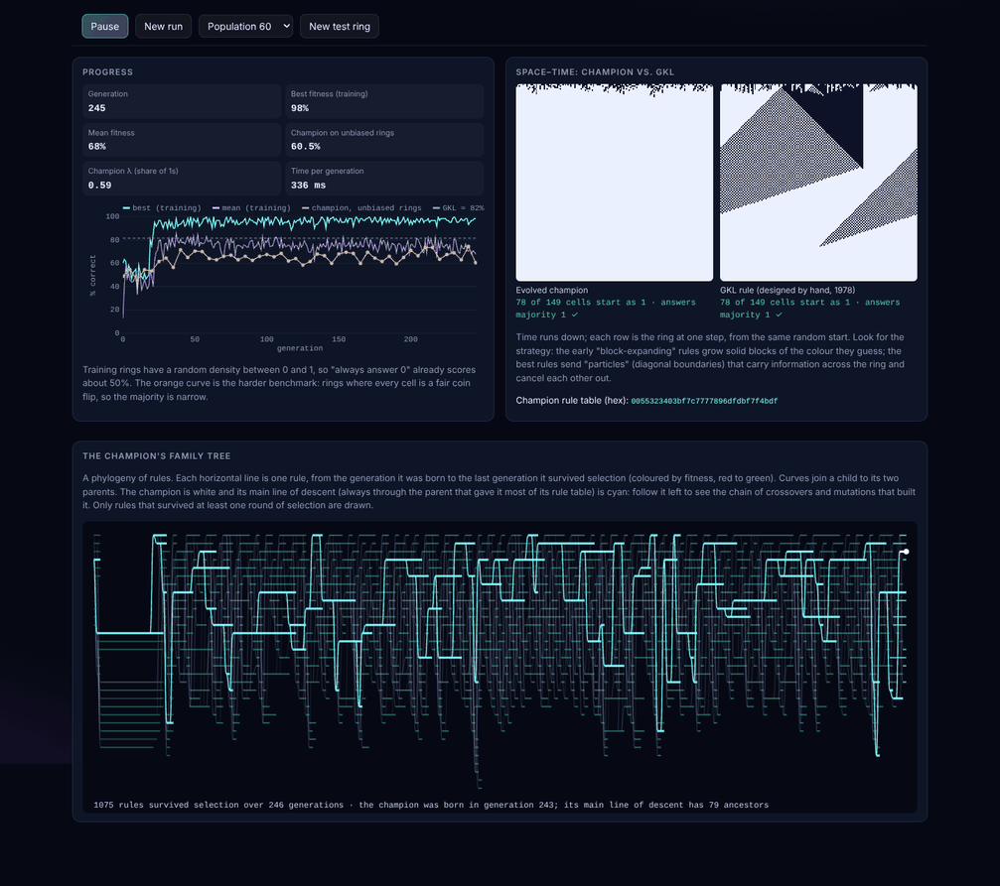
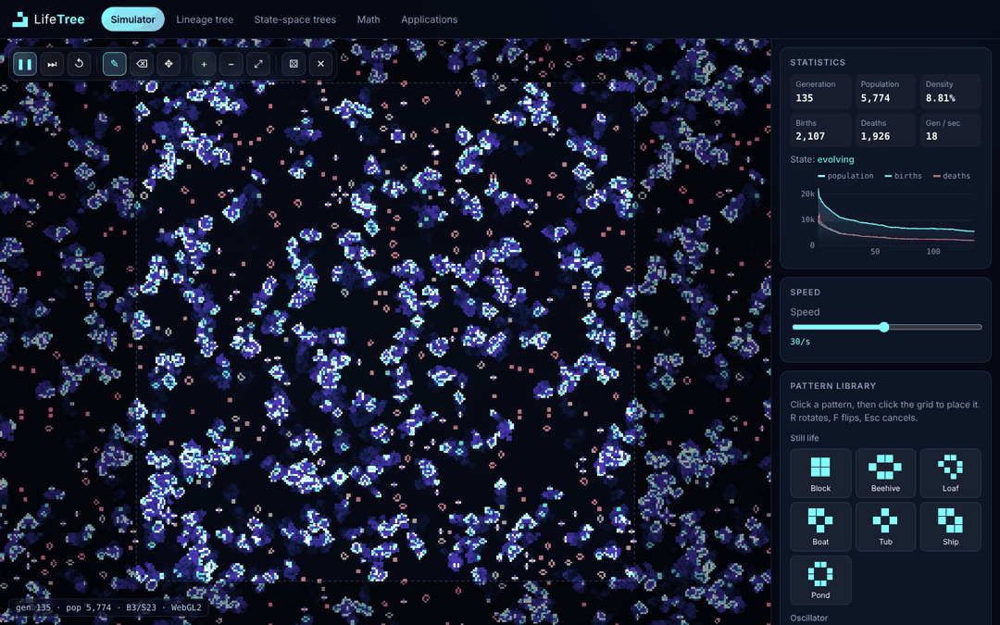

# Life Tree: a Game of Life explorer

An interactive, GPU-rendered exploration of **Conway's Game of Life**: a fast simulator you can draw on, a **lineage tree** that traces how every object in a pattern is born, splits, collides and dies, **state-space trees** that map every possible configuration of a small universe, a **3D spacetime** view, a **Hashlife** engine that jumps billions of generations, a **rule atlas** that classifies Life-like rules live, an **evolution lab** where a genetic algorithm breeds cellular automata and draws their family tree, a page of **mathematics** with live charts, and eighteen running demos of **real-world applications** of cellular automata, from heart arrhythmias and wind tunnels to phantom traffic jams and artificial organisms.

No backend, no accounts: it is a static Vite + TypeScript site that runs entirely in the browser.


## Features

### Simulator
- **WebGL2 renderer**: one GPU thread per pixel, with age-based colouring, fading death trails, glow, rounded cells and grid lines. Falls back to Canvas 2D when WebGL2 is unavailable.
- **Draw, erase, pan and zoom** with mouse, trackpad or touch (pinch to zoom).
- **Pattern library** of 27 classics (still lifes, oscillators, spaceships, methuselahs, guns, infinite growth) with thumbnails; rotate (R) and flip (F) before placing.
- **12 rule presets** (Life, HighLife, Day & Night, Seeds, Maze, Replicator, Anneal…) or type any `B/S` rule.
- Toroidal or bounded worlds from 64² to 1024², random and symmetric soups.
- Live statistics: population, births, deaths, density, speed, and automatic detection of still / oscillating / extinct states with the period.
- **RLE and plaintext import/export**, PNG screenshots and **video recording** (WebM) of the running simulation.

### Lineage tree
Pick a seed (or draw one in the simulator and press *Grow a lineage tree*). The app evolves it, splits the live cells into objects every generation and records which object each one came from. The result is drawn as a family tree, either **growing upward**, as a **radial** burst or as a **timeline**, on linear, √ or log time:
- forks are **splits**, joins are **collisions**, branch ends are **deaths**;
- surviving leaves are labelled with the object they became (Block, Beehive, Blinker, Glider ↗…);
- click a branch to highlight its full ancestry and descendants and scrub through the evolution with each object in its own colour;
- a summary and final census (the R-pentomino gives exactly the known 8 blocks, 6 gliders, 4 beehives, 4 blinkers, a boat, a loaf and a ship).


### 3D spacetime
Every live cell at every generation becomes a cube, with time running upward, drawn with WebGL2 instancing (hundreds of thousands of cubes in one draw call). Gliders become diagonal tubes, oscillators become braids and a methuselah like Acorn grows into a tree. Orbit, zoom, replay, colour by time or by object, and send any pattern from the simulator.



### Deep time (Hashlife)
A from-scratch implementation of Gosper's **Hashlife** algorithm: a hash-consed quadtree with memoised futures. Jump a glider gun to generation 2³² (4,294,967,296) in milliseconds, double the generation with one click, watch population against generation on a log–log chart, and see the tree level, unique node count and cache hit rate live. It is tested cell for cell against the direct engine.


### State-space trees
On a tiny torus (3×3 up to 3×6, up to 262,144 states) the app computes the successor of **every** configuration and draws the **basins of attraction**: each attractor cycle with the trees of states that flow into it (the "basin of attraction field" popularised by DDLab). Hover any state to see it and its trajectory; Garden of Eden states (no predecessor) are highlighted.


### Ancestors
Life run backwards. Draw a pattern and a backtracking search finds every **parent** in a box around it: every pattern that becomes exactly yours one generation later (a glider has 79 in a 5×5 box). Click a parent to search for its parents, and a family tree grows back in time; **Rewind** follows the smallest parent several generations at once. When nothing is found the page says so honestly: no parent of that size exists, which is not yet a proof of a Garden of Eden.



### Rule atlas
Conway's rule is one of 262,144 Life-like rules. The atlas runs 18 at a time from random soups and classifies each one live into **Wolfram's four classes** (dies out, settles, chaotic, complex) from its activity, density and whether the board repeats, alongside **Langton's λ**. Browse famous rules, random rules, or **Life and its 17 one-bit neighbours** to see how narrow Life's ridge between order and chaos is. Click any card to open that rule in the simulator.



### Evolution
A genetic algorithm, running in a Web Worker, breeds one-dimensional radius-3 rules (128-bit tables) for the **density classification task**: a ring of 149 cells must reach all 1s if most cells started as 1, and all 0s otherwise, using only local rules. Watch the fitness climb through the epochs Mitchell, Crutchfield and Das described, compare the champion's space–time diagram with the hand-designed **GKL** rule, and follow the champion's **family tree**: a phylogeny in which every surviving rule is a life line and the champion's main line of descent is highlighted back to the founding generation.



### Puzzles
Ten construction challenges, from "draw a still life" to "draw a period-3 oscillator" and "make a pattern that vanishes after at least 100 generations". Draw on a small grid, press **Check**, and the engine runs your pattern and decides. A wrong answer is told what its pattern actually does (for example "That pattern dies out after 4 generations"), and **Watch it run** plays it in place. Progress and drafts are saved in the browser.


### The math
A long-form page with KaTeX formulas and charts computed live from the same engine: the rule as a formula, convolution, counting rules and states, **mean-field theory** with a cobweb diagram checked against real soups, **block entropy**, **damage spreading**, the **speed of light**, growth rates of guns, **phase space and the Garden of Eden theorem**, a proof that the lineage tree is well defined, the **linear replicator rule over 𝔽₂**, Turing universality, Hashlife, a live **census of random soups** with a Zipf rank–frequency fit and Shannon diversity, **self-organised criticality and the sandpile group** (the abelian property, the group order as a determinant and spanning-tree count, the group identity drawn live, and a measured avalanche exponent), **rule space and the edge of chaos** (Langton's λ against live-classified random rules, and a proof that the replicator rule erases every pattern on a 2^k torus), and **evolving computation** (why local majority fails, how GKL works, the GA's fitness function, and the Land–Belew impossibility result, with live accuracy curves), and **every pattern in a 4×4 box**: Burnside's lemma counts the 8548 patterns up to symmetry, and all of them are run to their fate in a background thread, with the share of each outcome, fate by starting size, the lifespan distribution and a gallery of the longest-lived methuselahs, and **running time backwards**: parents as a constraint-satisfaction problem, and all 2^25 5×5 patterns stepped once to show how unevenly the 512 possible 3×3 results are reached (entropy 7.40 of 9 bits). See [docs/MATH.md](docs/MATH.md).

### Applications
Eighteen live demos, each new one backed by a unit-tested model in `src/engine/models/`. New in v4:
- **Phantom traffic jams**: Nagel–Schreckenberg cars on a ring road (after Sugiyama's 2008 experiment) with a space–time diagram of jams travelling backwards.
- **Segregation**: Schelling's model, where mild individual preferences produce strongly segregated towns.
- **Chemical waves**: the hodgepodge machine, a model of the Belousov–Zhabotinsky reaction's spirals.
- **Lenia**: continuous Life, with the gliding creature Orbium (click to release more).


New in v3:
- **Heart rhythm**: an excitable medium where a broken wave curls into a re-entrant spiral (arrhythmia) and a **Defibrillate** button stops it, with a crude ECG trace.
- **Wind tunnel**: an FHP **lattice gas** of about 100,000 particles flowing past a cylinder, plate or wing, shown as speed or vorticity with velocity arrows.
- **Avalanches**: the Abelian **sandpile** with a live power-law fit of avalanche sizes, or the fractal pile grown from one point.
- **Predators and prey**: **Wa-Tor** fish and sharks with population cycles and a Lotka–Volterra phase loop.
- **Snowflakes**: Reiter's hexagonal crystal-growth model with presets from dendrites to lacy plates.


The original nine: procedural **cave generation**, **forest fires** and self-organised criticality, **epidemic waves** (SIRS), **traffic jams** (Rule 184 with the fundamental diagram), **random numbers** from Rule 30, **image denoising** with the Anneal rule, **morphogenesis** (Turing-style spots and stripes), **Wireworld circuits** (diodes and fan-out, verified by simulation) and **Langton's ant**, plus nine more fields from seismology to neural cellular automata. See [docs/APPLICATIONS.md](docs/APPLICATIONS.md).

## Gallery

| Simulator | Math | Soup census |
| --- | --- | --- |
|  |  |  |

| Sandpile identity | Heart arrhythmia | Snowflake |
| --- | --- | --- |
|  |  |  |

| Every 4×4 pattern |
| --- |
|  |

## Quick start

Requires [Node.js](https://nodejs.org/) 20 or newer.

```bash
npm install
npm run dev        # open the printed http://localhost:5173 URL
```

Other scripts:

| Command | What it does |
| --- | --- |
| `npm test` | Runs the Vitest suite (engine, patterns, RLE, lineage, basins, Hashlife, the soup census, the rule classifier, the genetic algorithm and the application models) |
| `npm run build` | Type-checks and builds the static site into `dist/` |
| `npm run preview` | Serves the production build locally |

### Keyboard shortcuts (simulator)

| Key | Action |
| --- | --- |
| Space | Play / pause |
| N or . | Step one generation |
| R | Reset to the last start (or rotate a pattern being placed) |
| F | Flip the pattern being placed |
| D / E / H | Draw / erase / pan tool |
| + / − / 0 | Zoom in / out / fit |
| C | Clear |
| Esc | Cancel placing a pattern |

Right- or middle-drag pans in any tool; Shift-click places a pattern repeatedly.

## Project layout

```
src/
  engine/          pure TypeScript, no DOM, fully unit tested
    life.ts        grid engine (torus or bounded), ages and trails, sparse evolver
    rules.ts       B/S rule parsing and presets
    rle.ts         RLE + plaintext pattern formats
    patterns.ts    pattern library and the 8 symmetries of the square
    objects.ts     object detection, canonical forms, period / speed detection
    lineage.ts     lineage tree builder
    basins.ts      exhaustive state-space analysis and radial basin layout
    hashlife.ts    Hashlife: hash-consed quadtree with memoised successors
    census.ts      seeded random soups and object census
    classify.ts    Wolfram-class rule classifier and Langton's λ
    evolve.ts      1D rules, GKL, and a genetic algorithm for density classification
    exhaustive.ts  Burnside counts, D4 orbit representatives and a fate runner for small patterns
    puzzles.ts     puzzle definitions and their automatic checkers
    predecessors.ts  backtracking parent search and the 3×3 preimage census
    models/        sandpile, FHP gas, Wa-Tor, excitable medium, snowflakes, Lenia, Schelling, hodgepodge, traffic
  render/          WebGL2 grid shader (Canvas 2D fallback), instanced 3D spacetime renderer, palettes
  ui/              the eleven views (the GA runs in ui/evolveWorker.ts, the 4×4 census in ui/boxWorker.ts), charts, demos and small DOM helpers
tests/             Vitest specs
docs/              math, applications and the lineage-tree method
```

## Deploying to GitHub Pages

The repo includes `.github/workflows/pages.yml`. Push to `main`, then in the repository go to **Settings → Pages** and set **Source** to **GitHub Actions**. Every push builds and publishes the site at `https://<user>.github.io/<repo>/`. `.github/workflows/ci.yml` runs the tests and build on every push and pull request.

## Credits

The Game of Life was devised by John Horton Conway in 1970 and popularised by Martin Gardner in *Scientific American*. Pattern data follows the conventions of [LifeWiki](https://conwaylife.com/wiki/). Formulas are rendered with [KaTeX](https://katex.org/).

## License

MIT, see [LICENSE](LICENSE).
