# Life Tree: Conway's Game of Life on a Go board

[](https://github.com/Normansrule/game-of-life/actions/workflows/ci.yml)
[](https://normansrule.github.io/game-of-life/)
[](https://github.com/Normansrule/game-of-life/actions/workflows/release.yml)
[](https://github.com/Normansrule/game-of-life/releases/latest)

**[Open the web app](https://normansrule.github.io/game-of-life/)** · **[Download for Windows, macOS or Linux](https://github.com/Normansrule/game-of-life/releases/latest)** · [Setup](#setup-and-usage) · [Design](#design) · [Progress](#progress-tracker)

In 1970 John Conway and his students worked out the Game of Life by hand, with stones on a Go board. Life Tree hands you that board. Place a few stones, press play, and then follow them anywhere: forward through a **lineage tree** of every object that splits, collides and dies, backward to the patterns that could have come **before**, up into a **3D spacetime** sculpture, a quadrillion generations ahead with **Hashlife**, sideways into 262,144 other rules, and down into the **math** that explains it. There are also eighteen live demos of cellular automata out in the world, from heart rhythms and wind tunnels to phantom traffic jams.

It's a static site written in TypeScript and built with Vite. Everything runs in your browser: there's no server and no account. It also installs as an offline app, and there's a desktop app built from the same code.

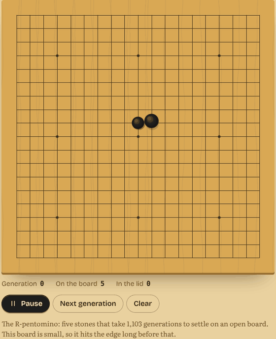

## Key features

- **A real board.** The simulator draws the grid as a Go board. Cells sit on the intersections as slate and clamshell stones, and each generation's births alternate black and white like turns, so you can see how old a pattern is. Zoom out and the stones become flat cells, which keeps a 1,024 × 1,024 board fast. It renders with WebGL2 (Web Graphics Library 2) and falls back to a plain canvas.
- **Lineage tree.** A family tree of every object in a pattern, laid out upward, radially or as a timeline.
- **Ancestors.** Runs the board backwards to find every pattern that could have produced yours one generation earlier.
- **3D spacetime and deep time.** Stack generations into a sculpture you can turn, or jump up to 2^50 generations ahead with Hashlife.
- **State-space trees.** Every configuration of a tiny board, and the cycle each one falls into.
- **Rule atlas, evolution and puzzles.** Eighteen rules run side by side and get classified as they go. A genetic algorithm breeds rules that compute. Ten puzzles are checked by the engine.
- **Math and applications.** Nineteen sections of math with live charts, and eighteen running models of real systems.
- **Daylight and Lamplight.** Light and dark colour modes that follow your system, or that you pick with the sun and moon button.
- **Works everywhere.** The layout works on phones, every control can be reached with the keyboard, and reduced-motion settings are respected.

| Daylight | Lamplight |
| --- | --- |
| 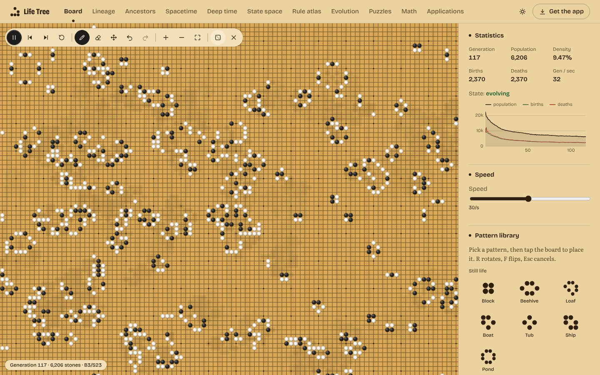 | 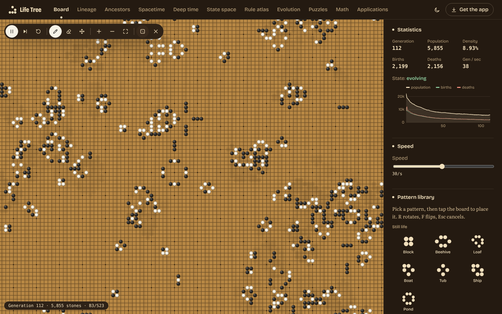 |

## Use it three ways

| | How | Works offline |
| --- | --- | --- |
| **Web app** | Open **[normansrule.github.io/game-of-life](https://normansrule.github.io/game-of-life/)** in any modern browser. | After the first visit |
| **Installed app** | Open the web app, press **Get the app** in the top bar, then **Install in this browser** (Chrome, Edge, Android). On iPhone or iPad, use Safari's *Share*, then *Add to Home Screen*. It's a PWA (Progressive Web App), so it gets its own window and icon. | Yes |
| **Desktop app** | Download it from the **[latest release](https://github.com/Normansrule/game-of-life/releases/latest)**. For Windows there's an `.exe` installer or a portable `.exe`. For macOS there's a `.dmg`, and for Linux an `.AppImage` or `.deb`. | Yes |

The desktop builds aren't code-signed, so each system warns you the first time:
- **Windows:** choose *More info*, then *Run anyway*.
- **macOS:** right-click the app and choose *Open*.
- **Linux:** run `chmod +x Life-Tree-*.AppImage` first.

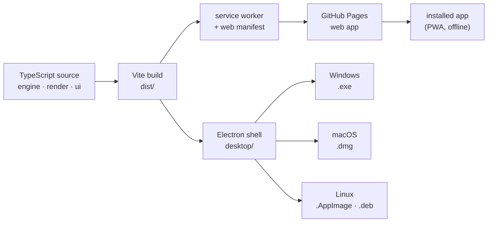

## Progress tracker

<!-- progress:start -->


**32 of 42 roadmap items done (76%).** Generated from the checklist below by `npm run progress`.

| Area | Progress | Done | Up next |
| --- | --- | --- | --- |
| Simulator | ▰▰▰▰▰▰▰▱▱▱ 71% | 5 / 7 | Share a pattern as a link; Load patterns straight from LifeWiki |
| Trees and time | ▰▰▰▰▰▰▰▱▱▱ 71% | 5 / 7 | Hashlife in a Web Worker for huge patterns; Export any tree as an SVG file |
| Math | ▰▰▰▰▰▰▰▰▰▱ 89% | 8 / 9 | Glider synthesis: building patterns from colliding gliders |
| Applications | ▰▰▰▰▰▰▰▰▱▱ 75% | 3 / 4 | Neural cellular automata that regrow an image |
| Games and labs | ▰▰▰▰▰▰▰▰▱▱ 75% | 3 / 4 | A daily puzzle |
| Apps and publishing | ▰▰▰▰▰▰▰▱▱▱ 73% | 8 / 11 | Intel Mac build; Code-signed installers |
<!-- progress:end -->

### Releases

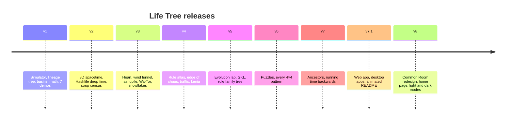

Full details in [CHANGELOG.md](CHANGELOG.md).

### Roadmap

Tick a box here and run `npm run progress` to redraw the bars above. CI fails if they are out of date.

<!-- roadmap:start -->
#### Simulator
- [x] WebGL2 renderer that draws the board as a Go board with stones (Canvas 2D fallback)
- [x] Draw, erase, pan, zoom and pinch on touch screens
- [x] 27-pattern library, 12 rule presets and any B/S rule
- [x] RLE and plaintext import and export
- [x] PNG screenshots and WebM video recording
- [ ] Share a pattern as a link
- [ ] Load patterns straight from LifeWiki

#### Trees and time
- [x] Lineage tree: upward, radial and timeline layouts
- [x] State-space trees (basins of attraction) on small tori
- [x] 3D spacetime with instanced cubes
- [x] Hashlife deep time to 2^32 generations and beyond
- [x] Ancestors: parent search and a family tree back in time
- [ ] Hashlife in a Web Worker for huge patterns
- [ ] Export any tree as an SVG file

#### Math
- [x] Mean-field theory, entropy, damage spreading, speed of light
- [x] Garden of Eden theorem and the replicator rule over F2
- [x] Soup census with a Zipf fit
- [x] Sandpile group and self-organised criticality
- [x] Rule space and the edge of chaos
- [x] Evolving computation (density classification)
- [x] Every pattern in a 4×4 box (Burnside, 8548 fates)
- [x] Running time backwards (2^25 pasts census)
- [ ] Glider synthesis: building patterns from colliding gliders

#### Applications
- [x] The original nine demos (caves, fires, epidemics, Rule 30 and more)
- [x] Heart, wind tunnel, sandpile, Wa-Tor and snowflakes
- [x] Traffic, segregation, chemical waves and Lenia
- [ ] Neural cellular automata that regrow an image

#### Games and labs
- [x] Rule atlas with live Wolfram classes
- [x] Evolution lab with a genetic algorithm and family tree
- [x] Ten puzzles checked by the engine
- [ ] A daily puzzle

#### Apps and publishing
- [x] Public GitHub repo with CI
- [x] Web app live on GitHub Pages
- [x] Installable, offline web app (PWA)
- [x] Desktop apps for Windows, macOS and Linux built in CI
- [x] First release with downloads (v7.1.0)
- [x] Animated README with GIFs and diagrams
- [x] Progress tracker in the README
- [x] Common Room redesign: a Go-board look with light and dark modes, and a home page
- [ ] Intel Mac build
- [ ] Code-signed installers
- [ ] Automatic updates in the desktop app
<!-- roadmap:end -->


## Features in detail

### The board (simulator)
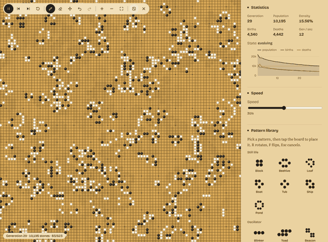

- **Go board renderer.** One GPU (graphics processing unit) thread works out each pixel. Lines run through the cell centres and star points sit every six lines. Stones are shaded and cast a small shadow. A newborn stone drops in on a spring, and a stone that dies lifts off and fades, at speeds slow enough to see it. You can colour the stones by turn, by age (white to black) or all slate. A plain canvas renderer takes over when WebGL2 isn't available.
- **Draw, erase, pan and zoom** with a mouse, trackpad or touch screen (pinch to zoom). A cleared board tells you how to get started again.
- **Pattern library** of 27 classics: still lifes, oscillators, spaceships, methuselahs, guns and infinite growth. Rotate with R and flip with F before you place one.
- **12 rule presets**, including Life, HighLife, Day & Night, Seeds, Maze, Replicator and Anneal, or type any `B/S` rule (the neighbour counts that cause a **B**irth and let a cell **S**urvive).
- Wrapped or bounded worlds from 64 to 1,024 lines across, plus random and symmetric soups.
- Live statistics: population, births, deaths, density and speed. It also spots when a pattern goes still, oscillates (and with what period) or dies out.
- **RLE (run-length encoded) and plaintext import and export**, PNG screenshots and WebM **video recording**.

### Lineage tree
Pick a seed (or draw one in the simulator and press *Grow a lineage tree*). The app evolves it, splits the live cells into objects every generation and records which object each one came from. The result is drawn as a family tree, either **growing upward**, as a **radial** burst or as a **timeline**, on linear, √ or log time:
- forks are **splits**, joins are **collisions**, branch ends are **deaths**;
- surviving leaves are labelled with the object they became (Block, Beehive, Blinker, Glider…);
- click a branch to highlight its full ancestry and descendants and scrub through the evolution with the rest of the board faded out;
- a summary and final census (the R-pentomino gives exactly the known 8 blocks, 6 gliders, 4 beehives, 4 blinkers, a boat, a loaf and a ship).

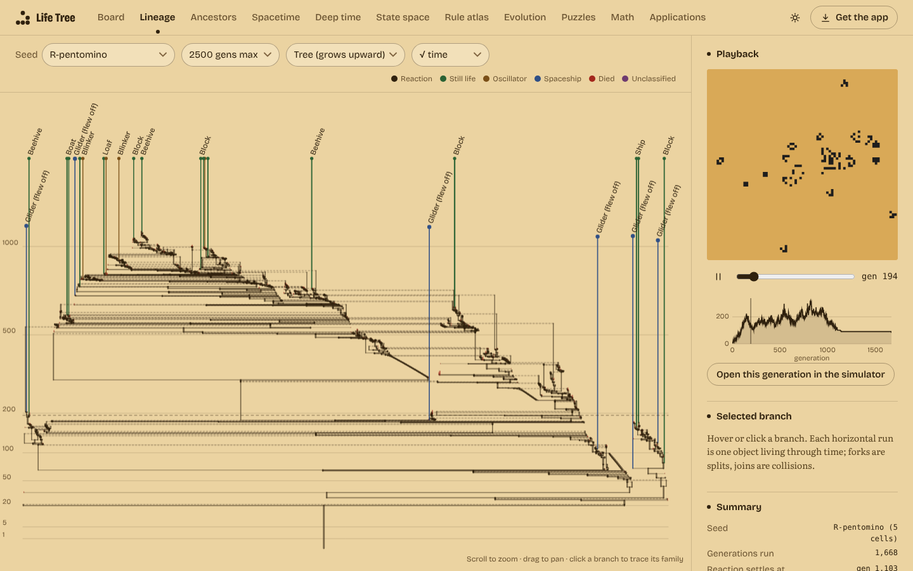

### 3D spacetime
Every live cell at every generation becomes a cube, with time running upward, drawn with WebGL2 instancing (hundreds of thousands of cubes in one draw call). Gliders become diagonal tubes, oscillators become braids and a methuselah like Acorn grows into a tree. Orbit, zoom, replay, colour by time or by object, and send any pattern from the simulator.

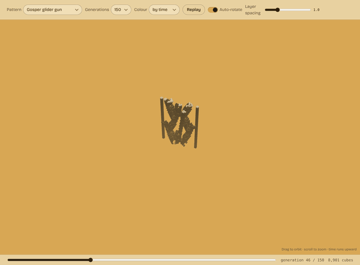

### Deep time (Hashlife)
A from-scratch implementation of Gosper's **Hashlife** algorithm: a hash-consed quadtree with memoised futures. Jump a glider gun to generation 2³² (4,294,967,296) in milliseconds, double the generation with one click, watch population against generation on a log–log chart, and see the tree level, unique node count and cache hit rate live. It is tested cell for cell against the direct engine.

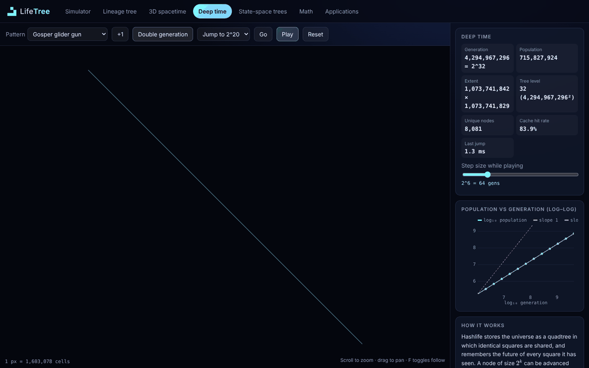

### State-space trees
On a tiny torus (3×3 up to 3×6, up to 262,144 states) the app computes the successor of **every** configuration and draws the **basins of attraction**: each attractor cycle with the trees of states that flow into it (the "basin of attraction field" popularised by DDLab). Hover any state to see it and its trajectory; Garden of Eden states (no predecessor) are highlighted.

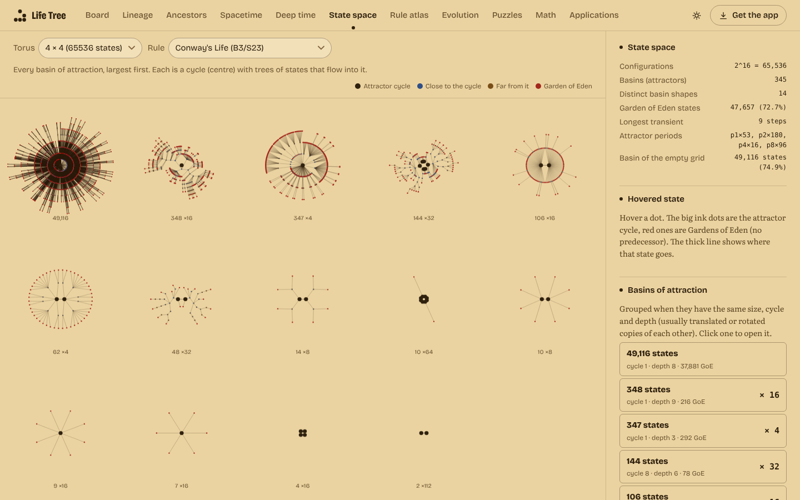

### Ancestors
Life run backwards. Draw a pattern and a backtracking search finds every **parent** in a box around it: every pattern that becomes exactly yours one generation later (a glider has 79 in a 5×5 box). Click a parent to search for its parents, and a family tree grows back in time; **Rewind** follows the smallest parent several generations at once. When nothing is found the page says so honestly: no parent of that size exists, which is not yet a proof of a Garden of Eden.

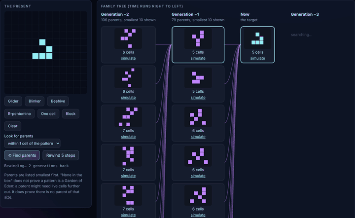

### Rule atlas
Conway's rule is one of 262,144 Life-like rules. The atlas runs 18 at a time from random soups and classifies each one live into **Wolfram's four classes** (dies out, settles, chaotic, complex) from its activity, density and whether the board repeats, alongside **Langton's λ**. Browse famous rules, random rules, or **Life and its 17 one-bit neighbours** to see how narrow Life's ridge between order and chaos is. Click any card to open that rule in the simulator.

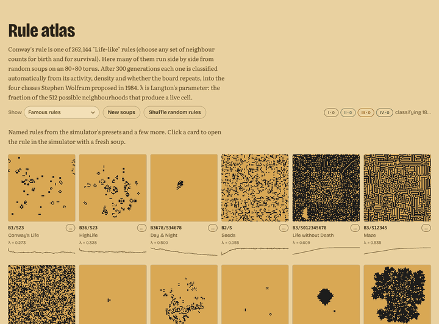

### Evolution
A genetic algorithm, running in a Web Worker, breeds one-dimensional radius-3 rules (128-bit tables) for the **density classification task**: a ring of 149 cells must reach all 1s if most cells started as 1, and all 0s otherwise, using only local rules. Watch the fitness climb through the epochs Mitchell, Crutchfield and Das described, compare the champion's space–time diagram with the hand-designed **GKL** rule, and follow the champion's **family tree**: a phylogeny in which every surviving rule is a life line and the champion's main line of descent is highlighted back to the founding generation.

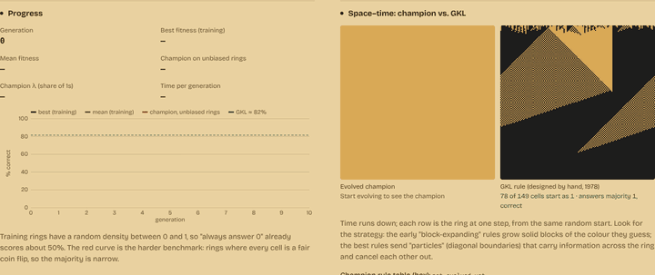

### Puzzles
Ten construction challenges, from "draw a still life" to "draw a period-3 oscillator" and "make a pattern that vanishes after at least 100 generations". Draw on a small grid, press **Check**, and the engine runs your pattern and decides. A wrong answer is told what its pattern actually does (for example "That pattern dies out after 4 generations"), and **Watch it run** plays it in place. Progress and drafts are saved in the browser.

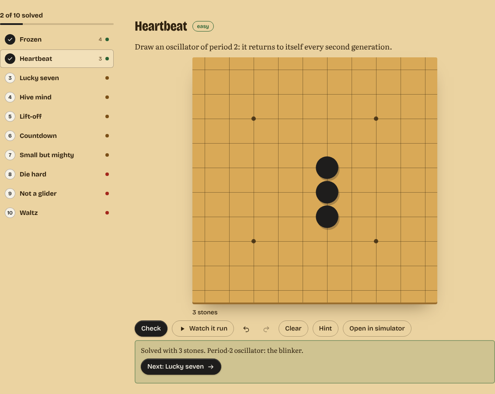

### The math
A long-form page with KaTeX formulas and charts computed live from the same engine: the rule as a formula, convolution, counting rules and states, **mean-field theory** with a cobweb diagram checked against real soups, **block entropy**, **damage spreading**, the **speed of light**, growth rates of guns, **phase space and the Garden of Eden theorem**, a proof that the lineage tree is well defined, the **linear replicator rule over the two-element field 𝔽₂**, Turing universality, Hashlife, a live **census of random soups** with a Zipf rank–frequency fit and Shannon diversity, **self-organised criticality and the sandpile group** (the abelian property, the group order as a determinant and spanning-tree count, the group identity drawn live, and a measured avalanche exponent), **rule space and the edge of chaos** (Langton's λ against live-classified random rules, and a proof that the replicator rule erases every pattern on a 2^k torus), and **evolving computation** (why local majority fails, how GKL works, the GA's fitness function, and the Land–Belew impossibility result, with live accuracy curves), and **every pattern in a 4×4 box**: Burnside's lemma counts the 8548 patterns up to symmetry, and all of them are run to their fate in a background thread, with the share of each outcome, fate by starting size, the lifespan distribution and a gallery of the longest-lived methuselahs, and **running time backwards**: parents as a constraint-satisfaction problem, and all 2^25 5×5 patterns stepped once to show how unevenly the 512 possible 3×3 results are reached (entropy 7.40 of 9 bits). See [docs/MATH.md](docs/MATH.md).

### Applications
Eighteen live demos, each new one backed by a unit-tested model in `src/engine/models/`.

| Heart arrhythmia | Wind tunnel | Snowflake |
| --- | --- | --- |
| 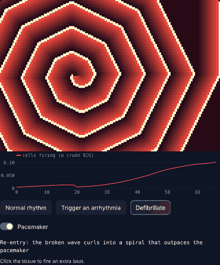 | 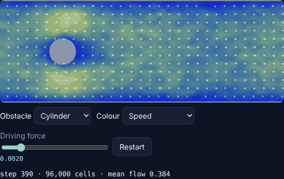 | 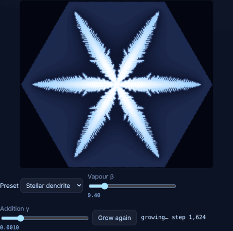 |

| Lenia | Phantom traffic jams |
| --- | --- |
| 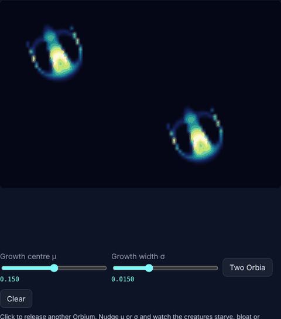 | 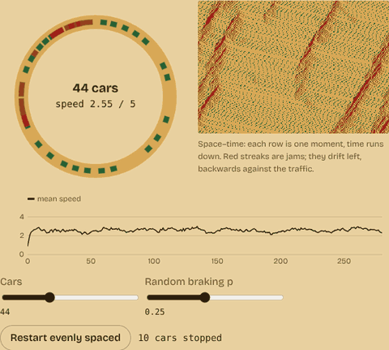 |

New in v4:
- **Phantom traffic jams**: Nagel–Schreckenberg cars on a ring road (after Sugiyama's 2008 experiment) with a space–time diagram of jams travelling backwards.
- **Segregation**: Schelling's model, where mild individual preferences produce strongly segregated towns.
- **Chemical waves**: the hodgepodge machine, a model of the Belousov–Zhabotinsky reaction's spirals.
- **Lenia**: continuous Life, with the gliding creature Orbium (click to release more).

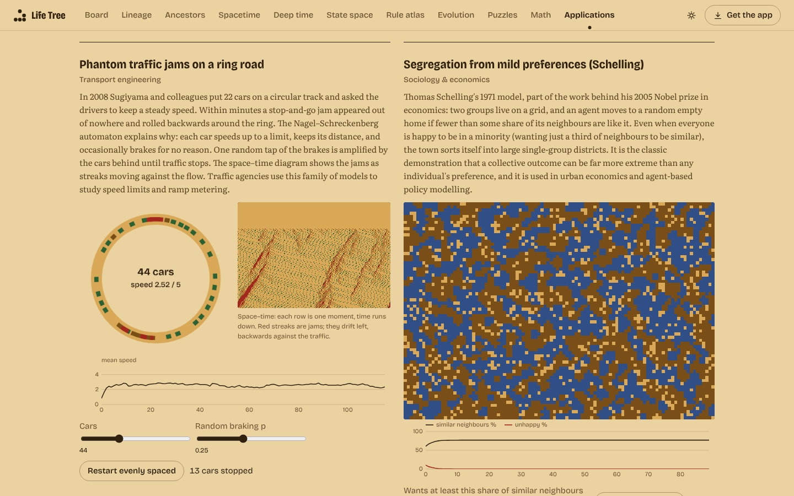

New in v3:
- **Heart rhythm**: an excitable medium where a broken wave curls into a re-entrant spiral (arrhythmia) and a **Defibrillate** button stops it, with a crude ECG trace.
- **Wind tunnel**: an FHP **lattice gas** of about 100,000 particles flowing past a cylinder, plate or wing, shown as speed or vorticity with velocity arrows.
- **Avalanches**: the Abelian **sandpile** with a live power-law fit of avalanche sizes, or the fractal pile grown from one point.
- **Predators and prey**: **Wa-Tor** fish and sharks with population cycles and a Lotka–Volterra phase loop.
- **Snowflakes**: Reiter's hexagonal crystal-growth model with presets from dendrites to lacy plates.

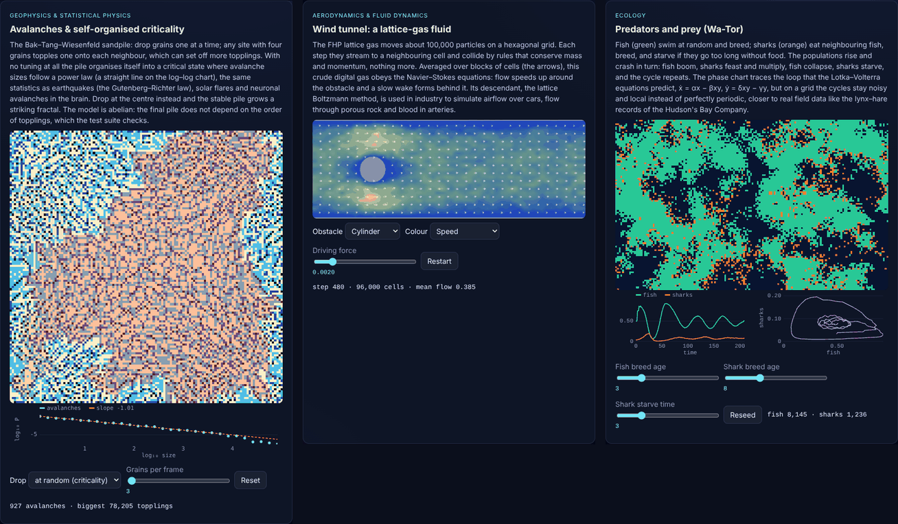

The original nine: procedural **cave generation**, **forest fires** and self-organised criticality, **epidemic waves** (SIRS), **traffic jams** (Rule 184 with the fundamental diagram), **random numbers** from Rule 30, **image denoising** with the Anneal rule, **morphogenesis** (Turing-style spots and stripes), **Wireworld circuits** (diodes and fan-out, verified by simulation) and **Langton's ant**, plus nine more fields from seismology to neural cellular automata. See [docs/APPLICATIONS.md](docs/APPLICATIONS.md).

## Gallery

| Home, Lamplight | Lineage tree | Math |
| --- | --- | --- |
| 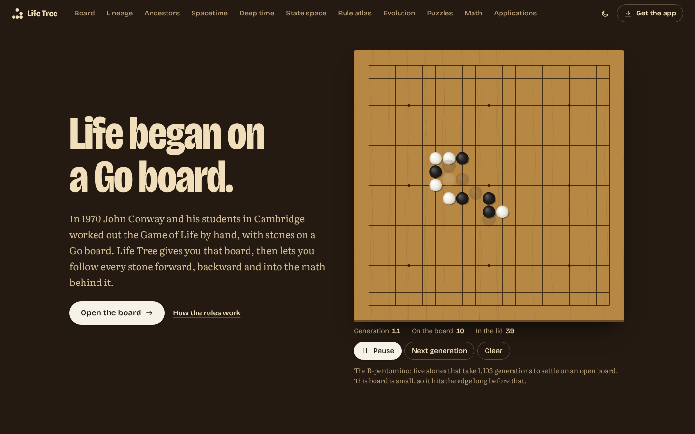 | 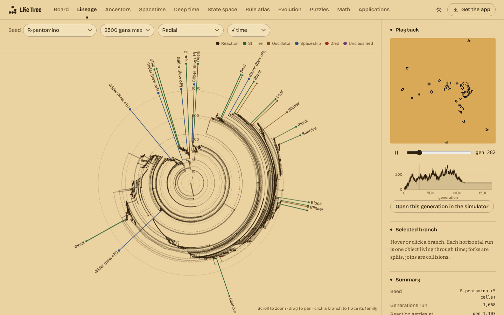 | 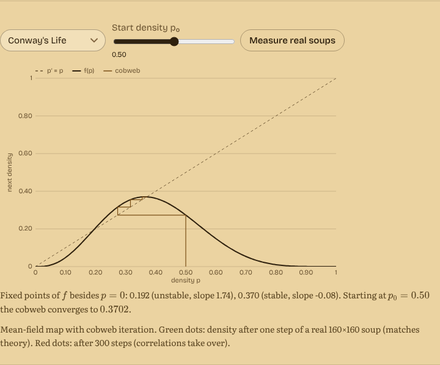 |

| Soup census | Sandpile identity | Heart arrhythmia |
| --- | --- | --- |
| 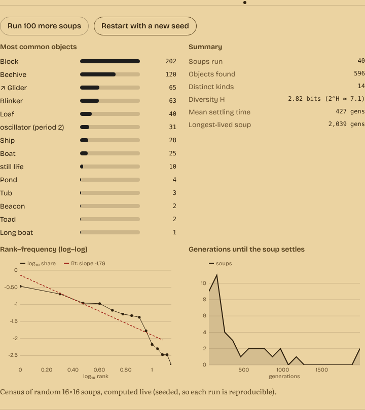 | 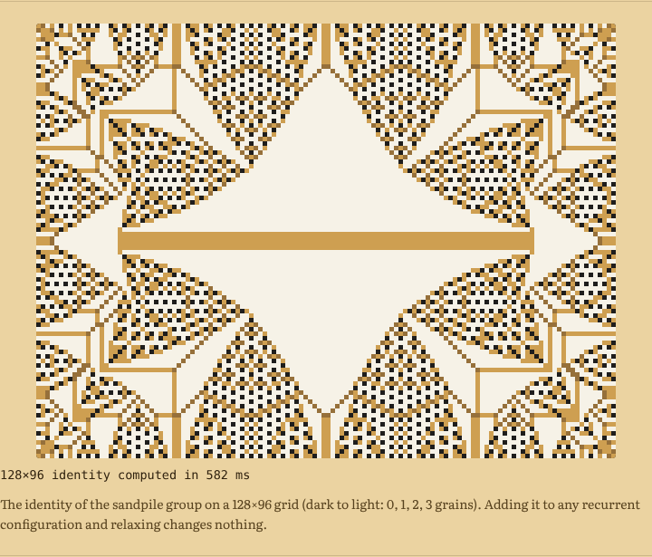 | 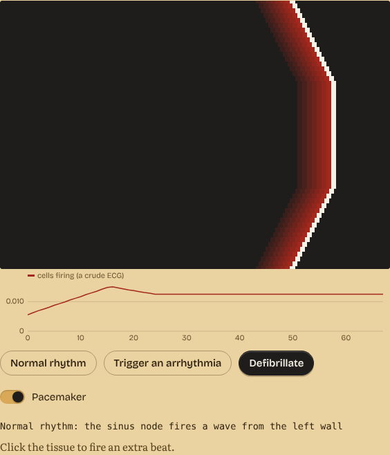 |

| Snowflake | Every 4×4 pattern | On a phone |
| --- | --- | --- |
| 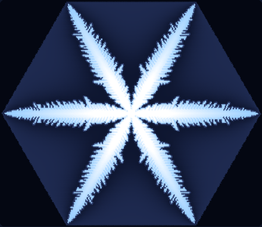 | 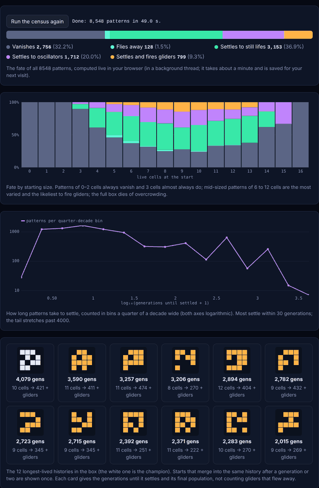 | 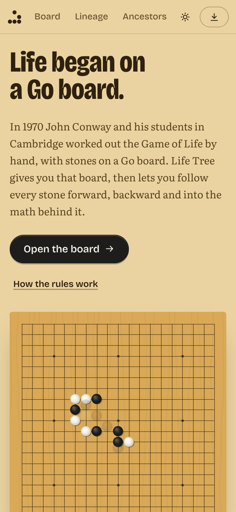 |

## Setup and usage

You need [Node.js](https://nodejs.org/) 20 or newer.

```bash
git clone https://github.com/Normansrule/game-of-life.git
cd game-of-life
npm install
npm run dev        # then open the http://localhost:5173 address it prints
```

| Command | What it does |
| --- | --- |
| `npm run dev` | Starts a development server that reloads as you edit |
| `npm test` | Runs the Vitest suite: engine, patterns, RLE, lineage, basins, Hashlife, the soup census, the rule classifier, the genetic algorithm, the application models and the progress tracker |
| `npm run build` | Type-checks and builds the static site into `dist/` |
| `npm run preview` | Serves the production build locally (installable, works offline) |
| `npm run progress` | Redraws the progress tracker from the roadmap checklist |

The site opens on the home page, and the top bar lists all eleven views. Your choice of colour mode is saved in the browser. The installed app and the desktop app skip the home page and open straight on the board.

### Keyboard shortcuts (board)

| Key | Action |
| --- | --- |
| Space | Play / pause |
| N or . | Step one generation |
| R | Reset to the last start (or rotate a pattern you're placing) |
| F | Flip the pattern you're placing |
| D / E / H | Draw / erase / pan tool |
| + / − / 0 | Zoom in / out / fit |
| C | Clear |
| Esc | Stop placing a pattern |

Right- or middle-drag pans with any tool, and Shift-click places a pattern again and again.

On the home page's board, the arrow keys move a cursor, Space places or lifts a stone and P plays or pauses. The cursor position is read out in Go coordinates, like K10.

## How it works

The engine is pure TypeScript with no DOM, so every view and every test runs the same code. Heavy searches run in Web Workers, with a main-thread fallback.

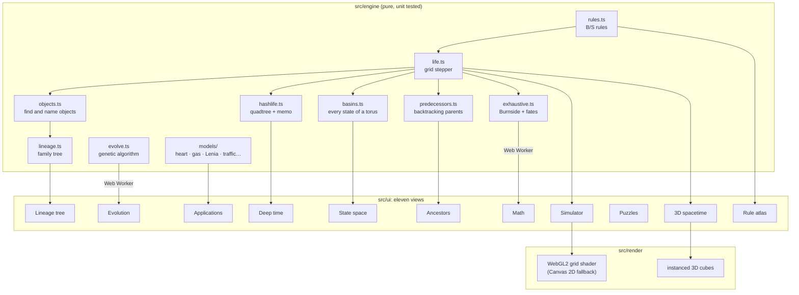

How the lineage tree is built, one generation at a time:

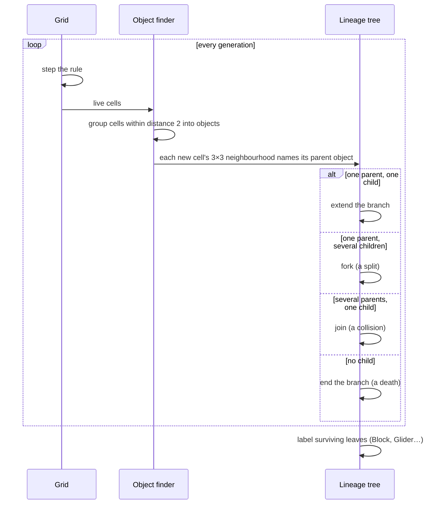

## Project structure

```
src/
  main.ts          routes between the views, colour-mode button, error fallback for a view that fails
  style.css        every design token (colour, type, spacing, motion) and all component styles
  engine/          pure TypeScript, no DOM, fully unit tested
    life.ts        grid engine (wrapped or bounded), ages and trails, sparse evolver
    rules.ts       B/S rule parsing and presets
    rle.ts         RLE + plaintext pattern formats
    patterns.ts    pattern library and the 8 symmetries of the square
    objects.ts     object detection, canonical forms, period / speed detection
    lineage.ts     lineage tree builder
    basins.ts      exhaustive state-space analysis and radial basin layout
    hashlife.ts    Hashlife: hash-consed quadtree with memoised successors
    census.ts      seeded random soups and object census
    classify.ts    Wolfram-class rule classifier and Langton's λ
    evolve.ts      1D rules, GKL, and a genetic algorithm for density classification
    exhaustive.ts  Burnside counts, D4 orbit representatives and a fate runner for small patterns
    puzzles.ts     puzzle definitions and their automatic checkers
    predecessors.ts  backtracking parent search and the 3×3 preimage census
    models/        sandpile, FHP gas, Wa-Tor, excitable medium, snowflakes, Lenia, Schelling, hodgepodge, traffic
  render/
    renderer.ts    the Go board shader (WebGL2) and its Canvas 2D fallback
    palettes.ts    stone colourings: turns, age, slate
    spacetime.ts   instanced 3D spacetime renderer
  ui/
    homeView.ts    the home page and its live 19-line board
    theme.ts       colour modes, and design tokens for canvas code
    icons.ts       the icon set (inline SVG on a 24-unit grid)
    ...            the other ten views, charts, demos and small DOM helpers
                   (the GA runs in evolveWorker.ts, the 4×4 census in boxWorker.ts)
tests/             Vitest specs
scripts/           the progress tracker generator
docs/              math, applications, the lineage-tree method, screenshots and the README GIFs (docs/media)
public/            web app manifest and icons
desktop/           Electron shell and installer config for the desktop app
```

## Design

The design is called **Common Room**, after the Cambridge maths common room where Life was first played on a Go board. The whole interface is that board, which gives the project a look that comes from its own history rather than from a template.

**Colour.** The page is planed kaya, the pale yellow wood Go boards are made from, and every board in the app is a deeper kaya (`#D9A957`). Slate (`#1E1D1C`) and clamshell (`#F6F2E7`) stones carry all the contrast. There's no accent colour at all, because the things you press are stones: a primary button is a slate pill, a switch is a stone sliding in a groove, and the active tab is marked by a star point. Charts and categories use a small set of earthy data colours (pine, vermilion, indigo, ochre, plum) that stay separate from the stones. In **Lamplight** (dark mode) the page turns to walnut and the board looks lamp-lit, so the stones still read the same.

**Type.** Headings are set in [Bricolage Grotesque](https://github.com/ateliertriay/bricolage), narrow and heavy, and the same family runs the controls. Reading text, from the math to the application write-ups, is [Literata](https://github.com/googlefonts/literata), a book face drawn for long reading on screens. Code and counters are monospace. Both fonts are bundled with the app, so the offline and desktop versions look the same as the website.

**Layout.** One board line (24 px) is the unit, and spacing goes in quarter, half, one, two and four lines. Sections start on a star point, the dot you'll see before panel and section headings. Panels are separated by thin rules rather than boxed in cards, and long reading text is capped at about 66 characters a line.

**Motion.** Things that land use a spring. Placed stones, the star point under the tabs, the switches and the toasts all settle with a small overshoot, like a stone clicking onto the board. State changes use one strong ease-out and stay under 300 ms. Presses scale to 97%. Hover effects only apply to a mouse or trackpad. With reduced motion turned on, overshoot, movement and loops are switched off and fades remain.

**States.** A cleared board says what to do next and offers a random soup or a glider. A view that fails to start shows what happened and a reload button, and the rest of the app keeps working. Searches and long runs show three stones being placed in turn while they work.

**Accessibility.** Text contrast is at least 4.5:1 in both modes. There's a skip link and a visible focus ring, every icon button has a label, and the toggles report whether they're on. The home board can be played entirely from the keyboard.

| Home, Daylight | Home, Lamplight |
| --- | --- |
| 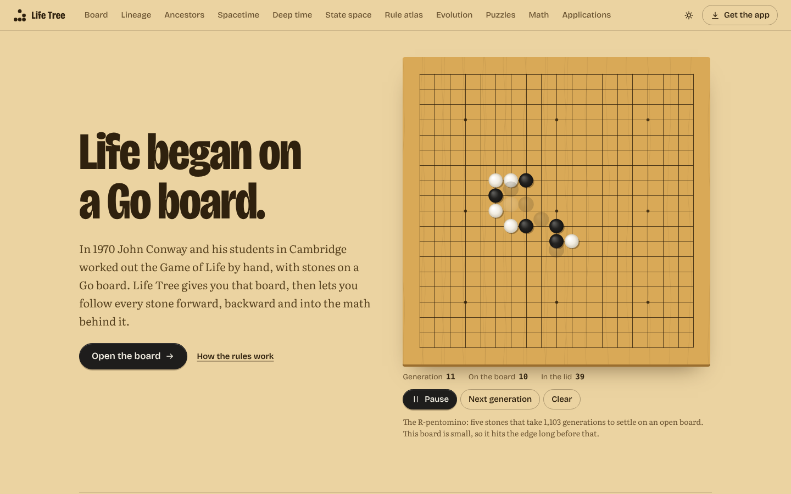 |  |

The other directions considered for this redesign were a microscope-slide look (stained cells) and a 1970s green-bar printout look. Common Room won because it's the most specific to Life's history and stays calm in a dense tool.

## Web app and desktop app

**Web app.** `.github/workflows/pages.yml` builds the site on every push to `main` and publishes it to GitHub Pages. Pages has to be switched to GitHub Actions once, which you can do from a terminal with `gh api -X POST repos/<owner>/<repo>/pages -f build_type=workflow` (or in **Settings → Pages → Source**). The build also writes a service worker (`sw.js`) that precaches every file, and `public/manifest.webmanifest` makes the site installable. `npm run build && npm run preview` shows the installable build locally.

**Desktop app.** `desktop/` wraps the same build in [Electron](https://www.electronjs.org/). It serves the files from a private `app://` scheme, so Web Workers and module scripts behave exactly as on the web.

```bash
npm install && npm run build      # build the site into dist/
cd desktop
npm install
npm start                         # run the desktop app
npm run dist                      # make installers for this OS in desktop/release/
```

**Releases.** `.github/workflows/release.yml` builds the Windows, macOS and Linux installers on all three operating systems. Pushing a tag such as `v7.1.0` publishes them as a GitHub release. The workflow also runs, without publishing, on pull requests that touch `desktop/`.

`.github/workflows/ci.yml` runs the tests and the build on every push and pull request.

## Credits

The Game of Life was devised by John Horton Conway in 1970 and popularised by Martin Gardner in *Scientific American*. Pattern data follows the conventions of [LifeWiki](https://conwaylife.com/wiki/). Formulas are rendered with [KaTeX](https://katex.org/). Fonts: Bricolage Grotesque by Mathieu Triay and Literata by TypeTogether, both under the SIL Open Font License, bundled through [Fontsource](https://fontsource.org/).

## License

MIT, see [LICENSE](LICENSE).
